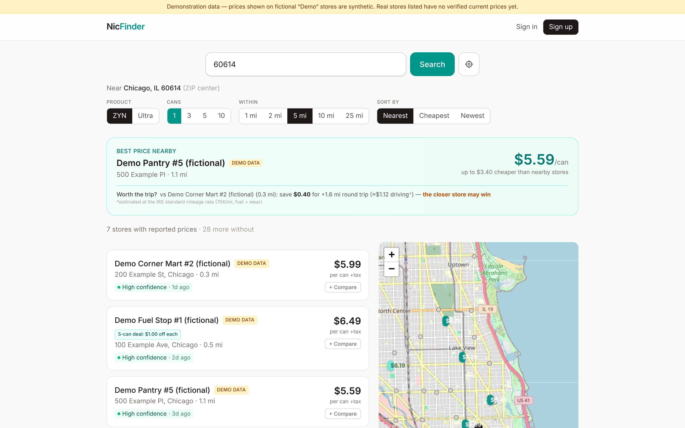

# NicFinder

Location-based price comparison for nicotine pouches (ZYN pilot, Chicago).
An informational service for adults 21+ — **no sales, checkout, delivery, or
nicotine marketing**. Browse free; sign in to confirm or correct prices.

The site works like a calmer GasBuddy for pouches: search any US address or
ZIP, see nearby stores on a list or map, compare single-can prices and
multi-can deal pricing, and see exactly how fresh and trustworthy every
number is. Prices arrive by **file import** (CSV/XLSX from a future calling
system — see `docs/IMPORT_CONTRACT.md`, or programmatically via the disabled-
by-default API in `docs/API.md`), by **community reports**, and by
**manual admin entry**. There is deliberately **no calling code** in this
application (`docs/ELEVENLABS_CALLING_RESEARCH.md` covers that future workstream).

<p align="center">
  
</p>

**📸 Full visual tour: [docs/screenshots/](docs/screenshots/README.md)** —
search, map, deals, store pages, community flows, and the whole admin suite.

## Quick start

Requires Node 20+ (tested on 22) and a PostgreSQL database. No paid
services or API keys needed.

**Database setup (pick one):**

- **Docker (easiest locally):**
  ```bash
  docker run --name nicfinder-pg -e POSTGRES_USER=nicfinder -e POSTGRES_PASSWORD=nicfinder_dev -e POSTGRES_DB=nicfinder -p 5432:5432 -d postgres:16
  ```
- **Shared cloud DB:** point `DATABASE_URL` at your Replit/Neon database
  (see `docs/REPLIT.md`) — no local install at all.
- **Native Postgres:** create a `nicfinder` database and matching user.

**App setup:**

```bash
npm install
cp .env.example .env          # set SESSION_SECRET and DATABASE_URL
npx prisma generate
npx prisma migrate deploy
npm run db:seed               # product lines, demo users, Chicago store directory
npm run dev                   # http://localhost:3000
```

Then search **60614** (the Chicago pilot area). Demo accounts are listed in
`docs/DEMO_GUIDE.md` (admin: `admin@example.com` / `admin-demo-password`).
**Deploying on Replit:** see `docs/REPLIT.md` (database, secrets, Replit Auth
SSO, Autoscale deployment, scheduled maintenance).

## Commands

| Command | What it does |
| --- | --- |
| `npm run dev` | Dev server on :3000 |
| `npm run build` / `npm start` | Production build / serve |
| `npm test` | 122 unit/integration tests (isolated Postgres test schema) |
| `npm run e2e` | ~41-check Playwright smoke test against a production build |
| `npm run lint` / `npm run typecheck` | ESLint / `tsc --noEmit` |
| `npm run db:seed` | Idempotent seed |
| `node scripts/make-sample-xlsx.mjs` | Regenerate the XLSX import sample |

## What's honest here (by design)

- Real Chicago stores from the exploratory research are listed as a
  **directory without prices** — the old spreadsheet is not evidence of
  current prices and is never shown as such.
- Synthetic prices appear only on clearly fictional "Demo …" stores, with a
  visible **demo data** badge and a site-wide banner (`DEMO_MODE` in `.env`).
- Unknown prices show as unknown. ZYN Ultra never inherits regular ZYN
  prices. Stale prices say they're stale. Outside covered areas you get a
  no-coverage message, never an invented result.

## Documentation map

| File | Contents |
| --- | --- |
| `HANDOFF.md` | Entry point for the next session: state, open items, gotchas |
| `DEVLOG.md` | Dated log of finished work, decisions, and lessons |
| `AUTONOMOUS_WORKLOG.md` | 2026-11-04/05 autonomous session — per-cycle evidence & recommendations |
| `AUTONOMOUS_BACKLOG.md` | Remaining ranked improvement ideas from that session |
| `UX_EXPERIMENTS_LOG.md` | UX/product experiment log: what, why, testing, keep/discard |
| `docs/REPLIT.md` | Replit deployment guide (DB, SSO, Autoscale, cron) |
| `docs/API.md` | Automated import API (bearer key, webhooks — disabled by default) |
| `docs/PRODUCT_REQUIREMENTS.md` | Scope, user flows, edge cases |
| `docs/ARCHITECTURE.md` | Data model, latest-price policy, security, Postgres path |
| `docs/IMPORT_CONTRACT.md` | CSV/XLSX schema, aliases, validation, idempotency |
| `docs/COMMUNITY_REPUTATION.md` | Trust scoring, publication rules, abuse defenses |
| `docs/ELEVENLABS_CALLING_RESEARCH.md` | Future calling system research (no code) |
| `docs/BUSINESS_RESEARCH.md` | Market/competitor/geo/financial research |
| `docs/DECISIONS.md` | Assumptions and why |
| `docs/PROGRESS.md` | Build status, how to resume |
| `docs/DEMO_GUIDE.md` | Demo script with accounts |
| `docs/ROADMAP.md` | Post-MVP priorities |

## Security & privacy notes

- Passwords: scrypt; sessions: random tokens stored hashed, httpOnly cookies.
- Google OAuth activates only when `GOOGLE_CLIENT_ID/SECRET` are set
  (`.env.example` documents the redirect URI). Without them the UI says so.
- Admin APIs check roles server-side on every route; the e2e suite verifies
  guests get 401/redirects.
- Never commit `.env`, database files, or the original research workbook
  (it contained credentials; `.gitignore` blocks `*.xlsx` outside
  `sample-data/`). Rotate any credentials that were in shared copies.

## Attribution

Map tiles © [OpenStreetMap](https://www.openstreetmap.org/copyright)
contributors. ZIP centroids from [GeoNames](https://www.geonames.org/)
(CC BY 4.0). Street-address geocoding via the public Nominatim API
(throttled to 1 req/s and cached; disable with `NOMINATIM_ENABLED=false`).
