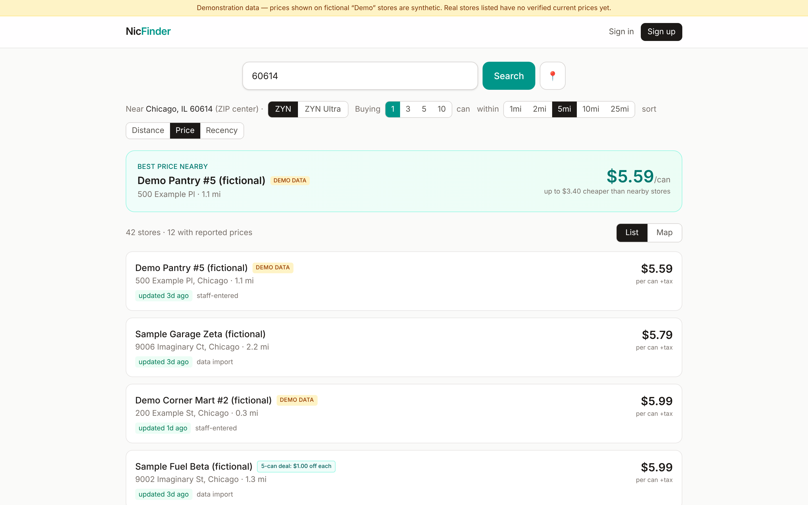
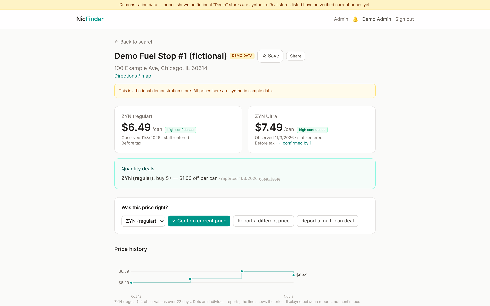
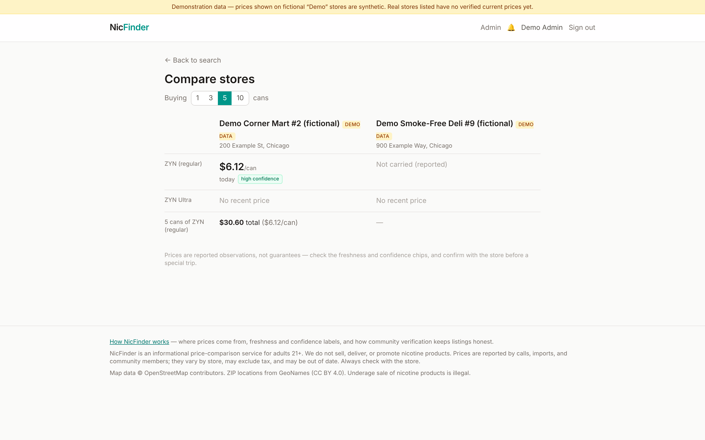
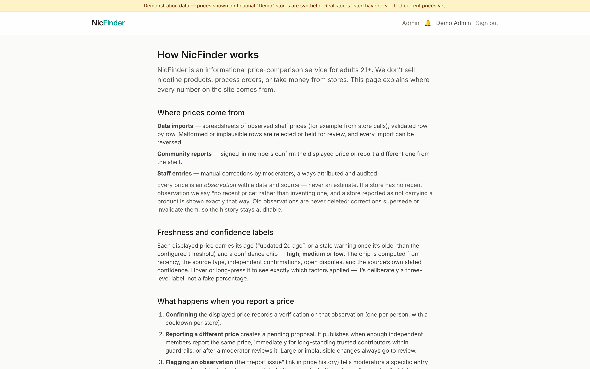
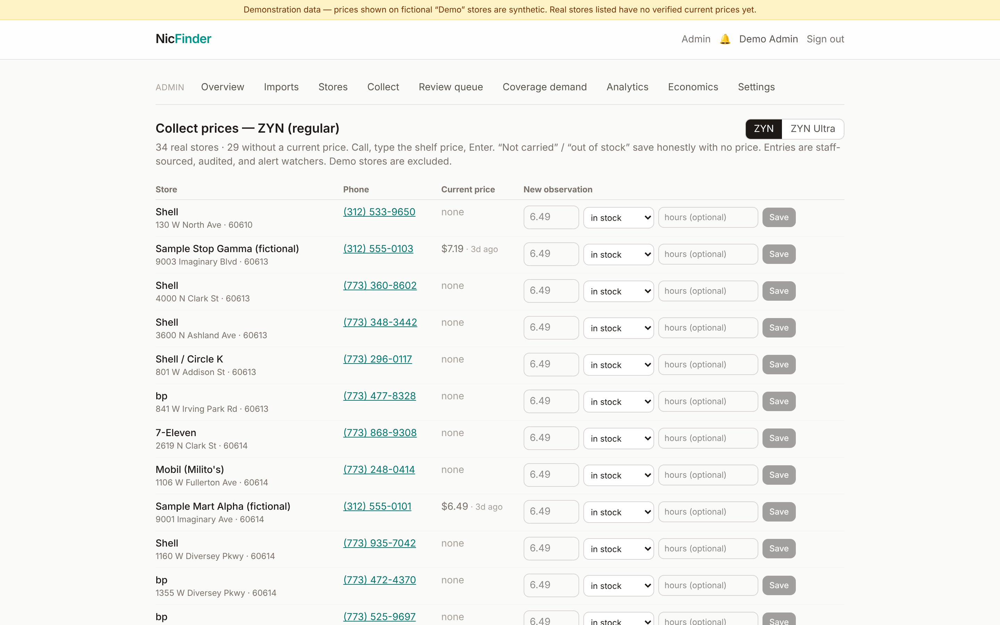
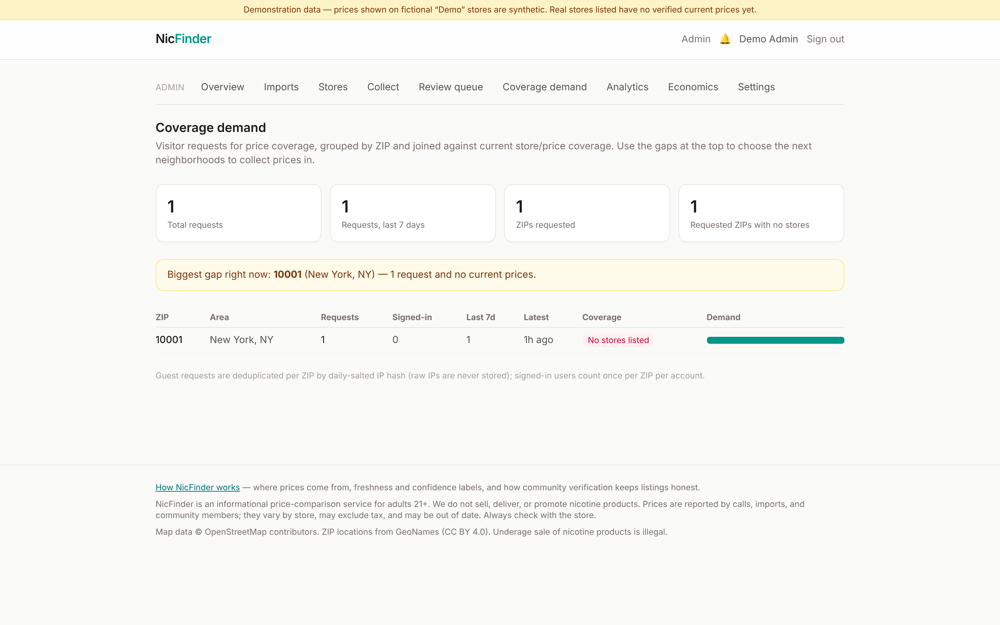
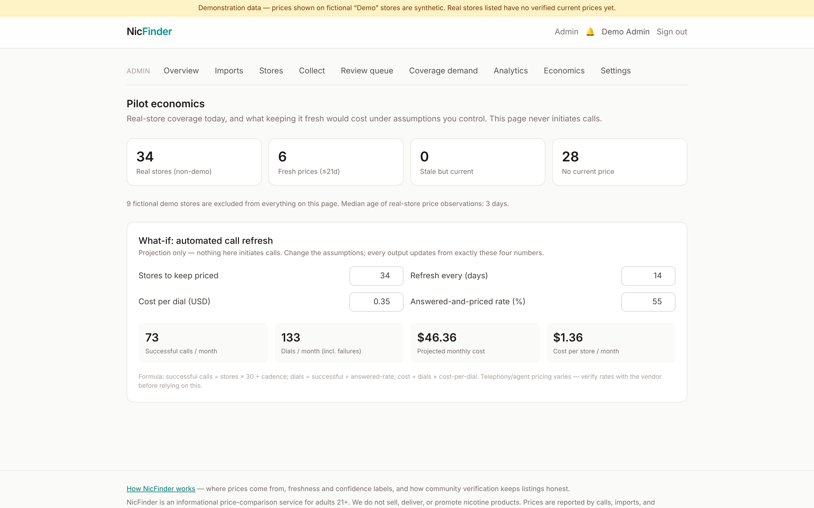
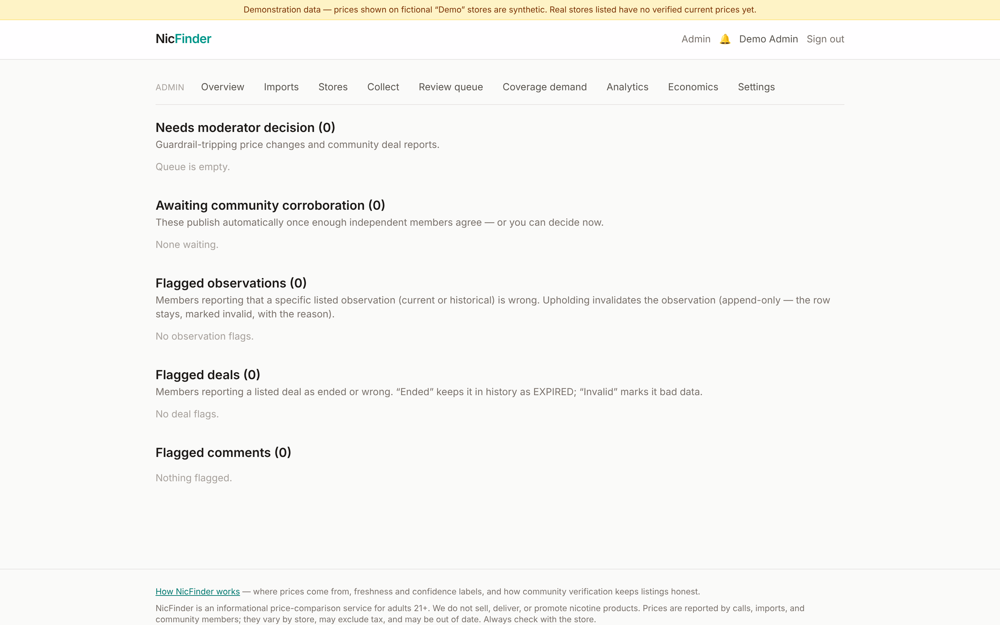
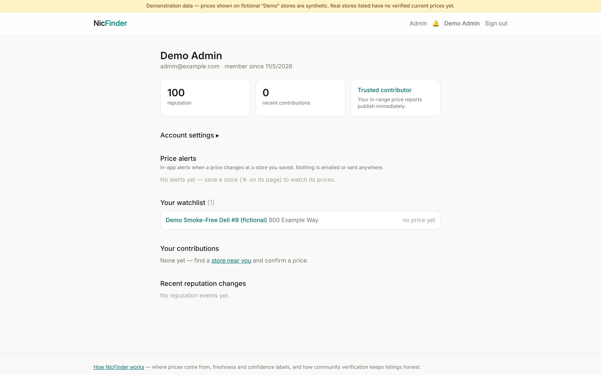

# Screenshot tour

Captured from a seeded local build (demonstration data — fictional "Demo"
stores carry synthetic prices; real directory stores honestly show "No
price yet"). Desktop shots at 1440×900, mobile at 390×844 (iPhone-class).

## Visitor experience

| | |
|---|---|
| **21+ age gate** — overlay (content stays indexable) |  |
| **Home** — one-box search, pilot stats |  |
| **Search results** — best-price hero card, freshness & source labels, honest "No price yet" states, deal badges |  |
| **Map view** — price pins on OpenStreetMap, gray "?" for unpriced stores |  |
| **5-can deal comparison** — effective per-can pricing re-ranks the list; single-can ranking never mixes with deal ranking |  |
| **Store detail** — per-product prices (ZYN vs ZYN Ultra never conflated), deal terms, price history, community notes |  |
| **Confirm / report a price** — community verification flow |  |
| **Account** — watchlist with latest prices, contribution history, reputation |  |
| **SEO landing page** — `/zyn-prices/60614`, one per covered ZIP |  |

## Admin

| | |
|---|---|
| **Overview** — live metrics, queues, audit log |  |
| **Import preview** — per-row validation outcomes, column remapping, commit/reverse |  |
| **Review queue** — guardrail-tripping price reports, flagged comments |  |
| **Coverage demand** — ZIPs users asked us to cover, ranked |  |
| **Analytics** — price dispersion by ZIP, freshness, contribution trends |  |
| **Settings** — every trust threshold in one place |  |

## Mobile

| | |
|---|---|
| **Search** |  |
| **Store detail** |  |

## Session 2 additions (2026-11-05, autonomous overnight session)

| | |
|---|---|
| **Store detail v2** — reliability chips, price-history sparkline, hours, nearby alternatives, flag/deal-report affordances |  |
| **Two-store comparison** — per-line prices and N-can deal math, honest not-carried states |  |
| **How it works** — trust explainer (data sources, confidence labels, verification flows) |  |
| **Admin: collect prices** — the G1 worksheet (tap-to-call, inline entry, availability-only facts) |  |
| **Admin: coverage demand** — requests by ZIP joined with store/price coverage |  |
| **Admin: pilot economics** — coverage stats + what-if call-cost calculator |  |
| **Admin: review queue v2** — disputes, deal reports, observation & deal flags, comments |  |
| **Account v2** — price alerts, settings, watchlist with quick-compare |  |
| **Dark mode (system preference)** — search |  |
| **Dark mode** — store detail with theme-aware sparkline |  |
