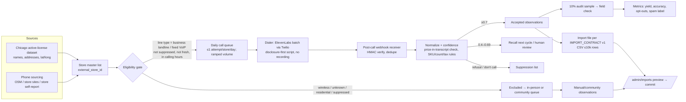

# 05 — Concurrent Calling Capacity, Throughput, and Chicago Launch Ramp

**Prepared:** 2026-11-04 · **Phase 5 of 7** · **Design in words and diagrams only. No implementation, no dialing.** Any automated calling requires Phase 1 Gate 2 (counsel opinion plus founder authorization) and the Phase 4 experiment's go criteria.
**Builds on:** Phase 4 unit model (base: 0.22 accurate prices per dial; ≈$0.098 all-in per dial; 49% of eligible stores yield an accurate price over a 2-week cycle). Labels as before: [V] [S] [S1] [A] [I] [M].

---

## Bottom line

1. **Chicago's store universe is now measured, not guessed:** the City's "Business Licenses – Current Active" dataset lists **1,904 active Tobacco licenses at 1,791 distinct addresses** (queried 2026-11-04) [V: data.cityofchicago.org, dataset uupf-x98q]. The repo's earlier "1,500–3,000" guess was in range. Its naive "~1,200 c-stores" figure undercounts the relevant universe, because tobacco licensees include pharmacies, groceries, liquor stores, and smoke shops.
2. **Neither concurrency nor throughput is the bottleneck.** With 5 concurrent lines (ElevenLabs Creator batch limit), a system could make about 1,500 dials a day, enough to dial every Chicago licensee in about a day. **The real limits are respectful cadence** (≤1 attempt per store per day, ≤6 attempts per 2-week cycle), **legal clearance, phone-number sourcing** (the license dataset has **no phone numbers**), and **cooperation**.
3. **Full-Chicago launch cost is small:** about **$1,200 one-time** to attempt all ~1,800 Chicago licensees plus inner-suburb overflow (3,000-store tier), yielding about **1,240 accurate prices**, then about **$200/month** to refresh. Costs exclude counsel, engineering, and the founder's time, all of which are larger.
4. **Recommended ramp:** a non-automated **manual and community pilot first** (Lincoln Park and Lake View, 122 licensees). Then, if cleared, a ≤200-store automated experiment (the Phase 4 design). Then contiguous expansion. **Never dial faster or from more numbers to get around answer-rate problems.** That is the pattern carriers and analytics engines flag as spam, and it would poison the number's reputation.
5. **Two non-calling alternatives are credible enough to run in parallel:** (a) in-person neighborhood sweeps plus community confirmations; (b) retailer self-reporting (a free verified store profile where owners post their own prices). Both have no telephone-law exposure.

---

## 1. Platform limits (verified where possible)

### Twilio
| Limit | Finding | Label |
|---|---|---|
| Outbound calls per second (CPS) | **Default 1 CPS per account** for API-created calls. Excess requests are **queued** (Twilio queues up to 24 hours of calls). On SIP trunks, excess calls fail with SIP 503. | [V: Twilio support article "Understanding CPS and Concurrent Call Limits"; Twilio API docs] |
| Raising CPS | **Conflicting sources:** API docs say accounts with an approved **Business Profile** can self-serve up to **5 CPS**; a Twilio blog says up to 30 CPS self-serve for Programmable Voice. Beyond that, ask the account team. | [V, conflicting] → check the console |
| Concurrent calls | Accounts newly upgraded with an **Individual** profile are **limited to 3 concurrent calls** (change effective for accounts upgraded after Feb 3, 2026). **Business profiles: unlimited.** | [V: Twilio support] |
| Trust / attestation | Trust Hub Business Profile → B attestation; plus a SHAKEN/STIR Trust Product with the number assigned → A attestation | [V via repo doc] |
| Pricing | $0.014/min outbound, $1.15/number/month, AMD $0.0075/answered call, Lookup line type $0.008 | [V, Phase 4] |

**Implication:** register a **Business** profile, not an Individual one. That avoids the 3-call concurrency cap, and it is required for A attestation anyway. At 1 CPS the account can start 3,600 calls an hour, far above any plan in this document.

### ElevenLabs
| Limit | Finding | Label |
|---|---|---|
| Plan concurrency | Free 4 · Starter 6 · Creator 10 · Pro 20 · Scale 30 · Business 40 · Enterprise "elevated" | [V via repo doc, pricing page 2026-11-04] |
| Batch calling concurrency | **min(50% of workspace concurrency, 70% of agent concurrency)** → Creator ≈5, Pro ≈10, Scale ≈15, Business ≈20 lines for batches | [V via repo doc] |
| Burst | Up to 3× the concurrency limit, with over-limit minutes at **$0.16/min** (2×) | [V/S] |
| Zero Retention | Not available for batch calls | [V via repo doc] |
| Other rate limits | API rate limits per plan not verified this session | [?] |

**How they interact:** the effective line count is min(ElevenLabs batch concurrency, Twilio concurrency, CPS × average call seconds). With a Twilio Business profile, ElevenLabs batch concurrency is the binding limit. **Avoid burst pricing.** At these volumes, scheduling across more hours is free and burst doubles the per-minute cost.

## 2. Throughput: theoretical vs. realistic

**Line occupancy per dial (base mix):** ring-out 28 s; voicemail 16 s (≈10 s ring + 6 s); refusal 28 s; success 68 s (≈8 s ring + 60 s); plus 5 s setup gap → **≈42 s average per dial → ≈86 dials per line-hour theoretical.** Realistic utilization is about 60%: batch scheduling gaps, retries spaced by policy, and time-zone/store-hour windows.

| Concurrent lines | Theoretical dials/hr | Realistic dials/hr | Realistic dials/day (6 calling hours) | Accurate prices/day (base) | Plan needed |
|---|---|---|---|---|---|
| 1 | 86 | 52 | 311 | 69 | Free/Starter |
| 5 | 431 | 259 | 1,553 | 343 | Creator (10 → 5 batch) |
| 10 | 863 | 518 | 3,106 | 685 | Pro (20 → 10 batch) |
| 20 | 1,726 | 1,035 | 6,212 | 1,370 | Business (40 → 20 batch) |
| 40 | 3,451 | 2,071 | 12,424 | 2,741 | Business + burst, or Enterprise |
| 100+ | 8,628 | 3,600 (capped by 1 CPS) | 21,600 | 4,765 | Enterprise + Twilio CPS increase |

**Why the realistic numbers matter less than they look [I]:**
- **Cadence caps per-store attempts:** ≤1 attempt per store per business day; voicemail and ring-out retries at a different daypart; refusers retried at most once after ≥7 days; "don't call" means never. A full first-pass cycle therefore takes **about 10 business days regardless of line count**.
- **Store hours and dayparts:** call 10:00–17:00 store-local time (stricter than the Illinois ATDA 9 a.m.–9 p.m. window), and avoid lunch and evening rush. For Chicago that is about 6 effective hours a day. A national program would stagger across time zones (Eastern first, Pacific last), which roughly extends the daily window to 9 hours.
- **Spam reputation:** carrier analytics engines label numbers by volume, short call durations, low answer rates, and complaints [I; general industry knowledge]. Bursting thousands of calls a day from a new number is exactly the pattern that earns a "Spam Likely" label. A label would cut answer rates and raise costs (Phase 4: answer rate and cooperation drive costs). **Ramp slowly:** start under 200 dials a day per number for the first weeks, raise gradually, use registered caller-ID name (CNAM "NicFinder"), register the number with the analytics engines through their free business registration portals [M], and monitor labeling. **Never rotate or spoof numbers to evade labels.** That is evasion, it can violate the Truth in Caller ID Act, and it is the opposite of the program's posture.

## 3. Chicago store universe and density (verified)

From the City's active-license dataset (2026-11-04):
- **1,904 active Tobacco licenses; 1,791 distinct addresses.** Expirations run Nov 2026–Dec 2027, so the snapshot is current.
- **Holders:** mostly independents. The biggest multi-site holders are Walgreens entities (Walgreen Co. 53, Bond Drug Co. 46), Osco/Jewel (American Drug Stores 34), Circle K (RDK Ventures 15), and airport and news-stand operators. **Roughly 85% are single-location or small operators** [I from top-holder counts]. Not every licensee stocks ZYN (some cigar lounges and some pharmacies). Assume 75–90% carry pouches [A].
- **Densest community areas:** Austin 91 · West Town 88 · Near North Side 79 · **Lake View 79** · Loop 74 · Near West Side 68 · Logan Square 67 · West Ridge 45 · Rogers Park 44 · Albany Park 44 · **Lincoln Park 43**.
- **Densest ZIPs:** 60647 (91), 60618 (89), 60639 (71), 60622 (62) … **60614 (48), 60657 (48), 60613 (39)**.
- **No phone numbers** are in the dataset. Phone acquisition must come from (a) OpenStreetMap where tagged, (b) open POI datasets (e.g., Foursquare's open-source Places release [M; verify license and fields]), (c) **manual lookup on the store's own website or signage** (≈1 min/store; ≈$0.17/store at $10/hr [A]), or (d) the store itself, via retailer self-reporting. **Avoid harvesting from Google Maps** (Phase 1 §5).

**Suburbs and beyond [A]:** the Chicago metro has about 9.4M people versus the city's ~2.7M. If suburban licensee density per capita is ~70–90% of the city's (≈0.66 per 1,000), the metro has about **4,500–6,000** tobacco licensees. A 10,000-store program therefore requires a second metro (Phase 6) or the full metro plus NW Indiana plus Milwaukee.

## 4. Chicago acquisition plan by tier (base case)

Assumptions: 85% of listed stores eligible after line-type scrub; ≈2.29 dials per eligible store per cycle; 49% of eligible stores yield an accurate price; ≈$0.098 all-in per dial; phone sourcing $0.17 per store; fixed = unused plan floor + number + trust fees. **Excludes counsel, engineering, and founder time.**

| Unique stores targeted | Footprint (contiguous) | Eligible dialed | Dials | Accurate prices | Calendar time | Concurrent lines needed | Calls + QA + lookup | Phone sourcing | Fixed | **Total one-time** | **Monthly refresh** |
|---|---|---|---|---|---|---|---|---|---|---|---|
| 100 | Lincoln Park + Lake View core (122 licensees) | 85 | 195 | ~41 | 2–3 weeks | 1 | $20 | $17 | $26 | **$63** | ~$39 |
| 500 | North Side band: Lake View, Lincoln Park, North Center, West Town, Logan Square, Near North, Loop | 425 | 973 | ~207 | 2–3 weeks | 1 | $100 | $85 | $75 | **$260** | ~$63 |
| 1,000 | North + Central + Northwest sides (~56% of city) | 850 | 1,946 | ~414 | 2–3 weeks | 1 | $200 | $170 | $40 | **$410** | ~$93 |
| 3,000 | **All Chicago (1,791)** + inner suburban Cook (Evanston, Oak Park, Cicero, Skokie…) | 2,550 | 5,840 | ~1,242 | 2–3 weeks | 2 | $599 | $510 | $100 | **$1,209** | ~$214 |
| 10,000 | Metro + NW Indiana + a second metro | 8,500 | 19,465 | ~4,140 | 3–4 weeks (multi-time-zone) | 7 | $1,995 | $1,700 | $300 | **$3,996** | ~$636 |

**Dials vs. accurate prices:** about 4.7 dials per accurate price in the base case. Conservative assumptions roughly double the dials and costs; optimistic ones roughly halve them (Phase 4 §6).

**Freshness:** monthly refresh accurately updates about 44% of known stores in the base case (Phase 4). Display "last confirmed" dates and lean on community confirmations to cover the rest.

**Break-even coverage [I]:** the monthly refresh for all of Chicago (~$214) is covered by **one** B2B customer at ~$500/month, or by consumer revenue at about 40–50k monthly users in the base case (Phase 3). Without either, run the refresh only for the densest 300–500 stores and rely on the community elsewhere.

**Phase 3 reconciliation note:** Phase 3 assumed $1.00 per store-month for data upkeep (base). Phase 5's calls-based refresh comes to about **$0.20–0.40 per known store-month**. Add in-person audits (10% × ~$4) and moderation, and an all-in figure of **$0.40–0.80** is more defensible. Phase 3's base therefore slightly understates consumer-only viability; it does not change the conclusion that B2B revenue is needed.

## 5. Density strategy: staged neighborhoods ("ink blot")

Value to a user is coverage within *their* 5–10 minute radius, so expand contiguously:
1. **Seed (≈120 licensees):** Lake View (79) + Lincoln Park (43). Existing repo footprint, dense, a young-adult professional population. Also DePaul-adjacent, so keep 21+ framing.
2. **Band 1 (+≈260):** North Center (20), West Town (88), Logan Square (67), Near North Side (79). Adds the "Loop-adjacent premium vs. neighborhood discount" contrast.
3. **Band 2 (+≈260):** Loop (74), Near West Side (68), Uptown (39), Edgewater (29), Lincoln Square (24), Avondale (40).
4. **Band 3: rest of the city** (~1,100 more), prioritized by **coverage-request demand** (the app already captures ZIP demand at /admin/coverage) and observed dispersion.
5. **Tax-arbitrage edges:** Evanston, Oak Park, and the **NW Indiana border** (Hammond, Whiting). Indiana's lower pouch tax should produce the largest spreads (Phase 6). **Calling into Indiana needs an Indiana-specific legal review** (Phase 1 §9); in-person and community collection don't.

## 6. Pilot designs

### 6.1 Recommended first: non-automated pilot (no counsel gate needed beyond Gate 0)
- **Scope:** 122 Lincoln Park + Lake View licensees.
- **Method:** two in-person sweeps two weeks apart (≈6–10 stores/hr walking, so ≈15–20 hours per sweep), plus **human** calls (identified as NicFinder, not recorded) for stores missed in person.
- **Outputs:** (1) the **dispersion number** (p10–p90 spread, business gate G1); (2) the share of stores that will quote by phone, and whether phone quotes match in-person observation (an early read on the PHR 2009 validity risk); (3) store-owner reactions; (4) 15- vs 20-count mix on shelves.
- **Cost:** ~40 hours of founder time, or ~$600–800 for a paid helper [A]; $0–$400 if cans are bought for receipts.

### 6.2 If cleared: automated experiment
- The Phase 4 §8 three-arm design (≈120 AI / 60 human / ground-truth visits) inside Bands 1–2, **business-landline-only after line-type scrub**, ≤200 dials a day.

### 6.3 Alternative A: community + retailer self-reporting (no calls)
- Free **verified store profile**: the owner verifies by a code mailed to the licensed address, or by a call *from* the store to NicFinder's number, then posts prices and deals with a timestamp, displayed as "store-reported." Spot-audit 10% in person.
- Cheap stores have an incentive to participate (it is free marketing). Expensive stores won't, so coverage will be biased toward cheap stores, and the UI must not imply coverage is complete.
- Community one-tap confirmations already exist in the app (COMMUNITY_REPUTATION.md).

### 6.4 Alternative B: data partnerships
- Distributors (who know wholesale cost and sometimes suggested retail), chain category managers (corporate price files), and POS or loyalty platforms. Long sales cycles, but each deal covers many stores at once. A partner feed produces exactly the import-contract CSV. **Approach these after the first B2B conversations** (Phase 3 §5), since the same people may become customers.

## 7. Operational architecture (words and diagram only)

**Mapping to the existing import contract (`docs/IMPORT_CONTRACT.md`):** `external_store_id` (master list key, e.g., `chi-lic-<license_number>`) · `store_name`, `address`, `zip`, `latitude`, `longitude` (from the license dataset) · `phone` · `observed_at` (with offset) · `product_line` (**use the slug `zyn-ultra`, not `zyn_ultra`**; the calling research doc's draft CSV uses an underscore that the contract doesn't define; register item D3) · `price_usd` · `tax_included` (blank if unknown) · `availability` · `confidence` · **`can_size` (15/20; essential during the pouch-count transition)** · deal columns · `source_row_id` (`{call_id}-{product_line}`) · `call_id` · `notes` (Twilio CallSid, audit status). One file per daily run, well under the 10,000-row limit.

**Gates encoded in the queue:** stop dialing automatically if, on any day, opt-outs exceed 3% of human-answered calls, any complaint arrives, a spam label is detected, or the audit accuracy for the prior 7 days falls below 90%.

## 8. Phased launch schedule with explicit gates

| Phase | Weeks | Activity | Exit gate (all required) | If gate fails |
|---|---|---|---|---|
| L0 | 1–4 | Gate 0 site launch; manual pilot in Lake View + Lincoln Park (§6.1); SEO pages; retailer self-report beta | Dispersion p10–p90 ≥ $1.50 (G1); ≥80 of 122 stores observed; ≥5 store owners claim profiles | Dispersion < $1.00 → pivot to cross-area/tax-arbitrage or B2B-only (business doc rule) |
| L1 | 5–8 | B2B conversations (5); counsel engagement *if* L0 passes; Band 1 manual/community expansion | ≥1 B2B buyer willing to pay ≥$500/mo (G6), **or** organic traffic trending to ≥5k impressions/mo (G2) | Neither → stay small; no calling spend |
| L2 | 9–12 | **Only with a counsel opinion + written founder authorization:** Phase 4 experiment (≤200 stores) | Phase 4 go criteria (accuracy ≥92%, ≤$0.75/accurate, opt-outs ≤2%, no spam label) | Fail → calling demoted to lead generation; rely on Alternatives A/B |
| L3 | 13–20 | Bands 2–3 automated + manual hybrid; ramp ≤200 → ≤800 dials/day/number over 4 weeks | Weekly audit accuracy ≥90%; complaint-free; freshness ≥60% of displayed prices ≤45 days | Pause and reassess; don't add numbers to push volume |
| L4 | 21+ | Suburbs and tax-arbitrage edges; second metro only after Phase 6 analysis and a state-law memo | Business gates G1–G6 in BUSINESS_RESEARCH §8.2; B2B revenue covers refresh cost | Hold at Chicago scale |

## 9. What would change this plan
- **Line-type scrub excludes >30% of Chicago numbers** (many owner cell phones) → automated coverage collapses toward pharmacies and chains. Manual and community collection becomes the primary method for independents, which are exactly where dispersion lives.
- **Spam labeling despite registration** → stop. The number's reputation is the program's capital.
- **Retailer self-reporting takes off** (≥25% of stores claim profiles within 3 months) → calling becomes optional verification.

## Sources (accessed 2026-11-04)
- **City of Chicago, Business Licenses – Current Active (dataset uupf-x98q), queried via the public SODA API** for license_description = "Tobacco": counts by business activity, legal name, ZIP, community area: https://data.cityofchicago.org/resource/uupf-x98q.json ; dataset catalog: https://catalog.data.gov/dataset/business-licenses ; Chicago tobacco license requirement: https://www.chicago.gov/city/en/sites/chicago-business-licensing/home/tobacco.html
- Twilio CPS and concurrency: https://support.twilio.com/hc/en-us/articles/40868960307995-Understanding-CPS-and-Concurrent-Call-Limits-in-Twilio ; https://www.twilio.com/docs/voice/api/call ; high-volume guidance: https://www.twilio.com/en-us/blog/high-volume-voice-considerations ; https://support.twilio.com/hc/en-us/articles/223180028-How-Fast-Can-I-Place-or-Receive-Phone-Calls-with-Twilio
- ElevenLabs concurrency, batch limits, burst: `docs/ELEVENLABS_CALLING_RESEARCH.md` §1.5–1.6 (verified 2026-11-04) and https://elevenlabs.io/pricing/agents
- Import contract: `docs/IMPORT_CONTRACT.md` (repo)
